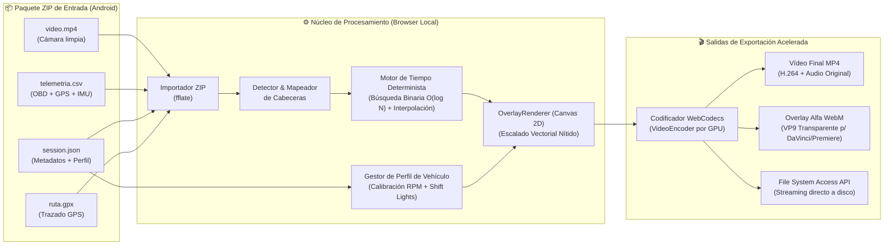

<div align="center">


# Tachyon Studio 🏁

```
  ████████╗ █████╗  ██████╗██╗  ██╗██╗   ██╗ ██████╗ ███╗   ██╗
  ╚══██╔══╝██╔══██╗██╔════╝██║  ██║╚██╗ ██╔╝██╔═══██╗████╗  ██║
     ██║   ███████║██║     ███████║ ╚████╔╝ ██║   ██║██╔██╗ ██║
     ██║   ██╔══██║██║     ██╔══██║  ╚██╔╝  ██║   ██║██║╚██╗██║
     ██║   ██║  ██║╚██████╗██║  ██║   ██║   ╚██████╔╝██║ ╚████║
     ╚═╝   ╚═╝  ╚═╝ ╚═════╝╚═╝  ╚═╝   ╚═╝    ╚═════╝ ╚═╝  ╚═══╝
                      S T U D I O
```

### **Suite de Telemetría Automovilística, Diseño de Overlays y Renderizado de Vídeo 100% Local**

[](https://www.typescriptlang.org/)
[](https://react.dev/)
[](https://vitejs.dev/)
[](https://developer.mozilla.org/en-US/docs/Web/API/WebCodecs_API)
[](https://vitest.dev/)
[](LICENSE)

[**Características**](#-características-destacadas) •
[**Arquitectura**](#-arquitectura-del-sistema) •
[**Widgets**](#-catálogo-de-widgets) •
[**Formatos**](#-formato-de-exportación-admitido) •
[**Guía Rápida**](#-instalación-y-uso) •
[**Comparativa**](#-comparativa-técnica)

</div>

---

## ⚡ ¿Qué es Tachyon Studio?

**Tachyon Studio** es la herramienta de escritorio complementaria de la app móvil Android **Tachyon**. Permite descargar en el PC todo el procesamiento pesado de sincronización, diseño de instrumental e incrustación sobre vídeo **directamente en el navegador**.

* 🔒 **100% Offline y Privado:** No requiere cuentas, no tiene servidores, no envía telemetría ni sube vídeos a la nube.
* 💸 **100% Gratuito y Libre:** Sin suscripciones, sin límites de tiempo y **sin marcas de agua**.
* 🏎️ **Diseño Profesional de Instrumental:** Overlays vectoriales nítidos calibrados para tu vehículo exacto (línea roja, luces de cambio, corte de inyección).
* ⚡ **Aceleración por Hardware:** Renderiza vídeos finales a más velocidad que tiempo real mediante la GPU con **WebCodecs**.

---

## 🏗️ Arquitectura del Sistema



---

## 🏎️ Características Destacadas

### 1. Motor de Sincronización Determinista
* **Sincronización Sub-Frame:** Vinculación exacta entre la marca temporal del vídeo y los sensores monotónicos (`time_offset_video_sec = 0.000` en el fotograma 0).
* **Tratamiento de Muestras Negativas:** Soporta registros capturados antes del inicio de grabación de vídeo ($t < 0.000\,\text{s}$).
* **Regla Estricta de Datos:** Las celdas vacías se tratan estrictamente como `null` (**nunca como 0**). Las ausencias de señal prolongadas activan el estado `"N/D"` con atenuación visual.
* **Separación de Aceleraciones:** Diferenciación matemática entre la aceleración inercial del acelerómetro ($\text{IMU}$) y la derivada longitudinal de la velocidad GPS ($a = \frac{dv}{dt}$).

### 2. Perfil de Vehículo Calibrado
* **Tacómetro Idéntico a tu Coche:** Escala máxima personalizable (`scale_max`), inicio de zona roja (`redline_start`), divisor de dígitos y corte de encendido.
* **Shift Lights Progresivas:** Matriz LED con 3 patrones de encendido (`left_to_right`, `center_out`, `right_to_left`) y colores por rango de RPM.
* **Aviso Estroboscópico `⚡ SHIFT!`:** Parpadeo sincronizado a $8\,\text{Hz}$ al alcanzar el punto óptimo de cambio de marcha.
* **Simulador de Régimen en Vivo:** Calibra y prueba la respuesta del tablero virtual con un deslizador de RPM interactivo sin necesidad de cargar un vídeo.

### 3. Editor Visual de Plantillas Multirresolución
* **Lienzo Interactivo:** Arrastra, alinea y redimensiona widgets en 8 direcciones con guías magnéticas y cuadrícula de referencia proporcional.
* **Soporte Completo de Resoluciones:**
  * **720p HD** (1280 x 720)
  * **1080p Full HD** (1920 x 1080)
  * **2K QHD** (2560 x 1440)
  * **4K Ultra HD** (3840 x 2160)
* **Escalado Proporcional Inteligente:** Al cambiar la resolución objetivo, la posición relativa y las proporciones de los widgets se conservan automáticamente mediante `scaleTemplate()`.
* **Renderizado Vectorial Nítido:** Tipografías, grosores de aguja y radios escalan dinámicamente con las dimensiones de cada widget, garantizando nitidez cristalina en pantallas de alta densidad de píxeles (HiDPI / Retina).

### 4. Exportación Acelerada por Hardware (WebCodecs)
* **Codificación Ultrarrápida por GPU:** Aprovecha la API nativa `VideoEncoder` del navegador para exportar más rápido que tiempo real.
* **Salida 1 — Vídeo Completo MP4:** Renderiza el vídeo con el overlay fusionado y preserva la pista de audio original.
* **Salida 2 — Overlay Transparente WebM (Canal Alfa):** Exporta únicamente el panel de instrumentos con fondo transparente (códec VP9 con alfa) para importar directamente como pista superior en **DaVinci Resolve**, **Adobe Premiere Pro** o **Final Cut Pro**.
* **Streaming Directo a Disco (Vídeos Largos y 4K):** Mediante la **File System Access API** (`showSaveFilePicker`), los trozos de vídeo se escriben directamente al disco sin saturar la memoria RAM.

---

## 📊 Catálogo de Widgets

Tachyon Studio incluye una biblioteca modular de widgets listos para combinar:

| Widget | Icono | Descripción | Fuentes de Datos |
| :--- | :---: | :--- | :--- |
| **Tacómetro Circular** | ⏱️ | Reloj analógico con aguja suave, arco de zona roja personalizable y lectura digital. | `engine_rpm` (OBD) |
| **Tacómetro de Barra GT** | 📊 | Barra horizontal de competición con gradiente dinámico y marcas cada 1.000 RPM. | `engine_rpm` (OBD) |
| **Shift Lights** | ⚡ | Tira de LEDs progresivos con parpadeo estroboscópico de aviso de cambio de marcha. | `engine_rpm` + Perfil |
| **Indicador de Marcha** | 🔢 | Visualizador de marcha engranada gigante (`1` a `6`, `N`, `R`) con advertencia en corte. | RPM / Velocidad / OBD |
| **Velocímetro Digital** | 🚀 | Visualizador numérico principal de alta visibilidad con selector $\text{km/h}$ o $\text{mph}$. | `gps_speed_kmh` / `obd_speed_kmh` |
| **Pedales Freno y Gas** | 🚦 | Doble barra vertical estilo F1 (acelerador en verde neón, frenada en rojo por deceleración). | `throttle_pct` + $\text{G}_{\text{long}}$ |
| **Barra de Acelerador** | 🟩 | Indicador vertical compacto de recorrido del pedal de acelerador ($0 \dots 100\%$). | `throttle_pct` (OBD) |
| **Temperatura de Motor** | 🌡️ | Termómetro digital de refrigerante con alerta por sobrecalentamiento ($^\circ\text{C}$ / $^\circ\text{F}$). | `coolant_temp_c` (OBD) |
| **G-Meter (Círculo de Kamm)** | 🎯 | Gráfica de fuerzas G biaxiales con círculos de adherencia ($0.5\text{G}$, $1.0\text{G}$, $1.5\text{G}$). | $\text{IMU}_{\text{lat}}$ + $\text{IMU}_{\text{long}}$ |
| **Trazada GPS** | 🗺️ | Mapa de circuito con polilínea de trazado, posición en tiempo real y vector de rumbo. | GPS (`lat`, `lon`, `bearing`) |
| **Perfil de Velocidad** | 📈 | Gráfica temporal continua de velocidad con aguja sincronizada al instante actual. | Velocidad vs. Tiempo |
| **Cronómetro de Sesión** | ⏱️ | Contador de minutos, segundos y décimas con soporte de marcas negativas previas al vídeo. | Reloj de sincronización |

---

## 🎨 Plantillas Integradas

El editor incluye disposiciones prediseñadas listas para usar con un clic:

1. **🏆 MyChron 5 Cockpit (Por Defecto):** Disposición completa para tandas y trackdays inspirada en los cuadros de telemetría de competición (tacómetro circular, shift lights, velocímetro, pedal, G-meter, mapa GPS y perfil de velocidad).
2. **🏁 Cockpit GT3 Pro (Display Carreras):** Cuadro horizontal moderno con tacómetro de barra, marcha engranada gigante, pedales duales freno/gas y temperatura de refrigerante.
3. **⚡ Barra Inferior Minimalista:** Instrumental compacto concentrado en la zona baja de la pantalla para dejar libre el campo visual de la pista.

---

## 📂 Formato de Exportación Admitido

Tachyon Studio importa directamente el archivo `.zip` que genera la app móvil Android al pulsar **Exportar ZIP**:

```text
sesion_tandas_circuito.zip
├── video.mp4               # Vídeo limpio grabado por la cámara del teléfono
├── telemetria.csv          # Muestras normalizadas con time_offset_video_sec
├── session.json            # Metadatos, eventos (corte GPS/OBD) y vehicle_config
├── ruta.gpx                # Trazado GPS estándar 1.1 con elevación y velocidad
└── LEEME_SINCRONIZACION.txt # Documentación del instante de sincronización
```

### Tolerancia y Autodetección de Esquemas
* **Formato Ancho Oficial (20 columnas):** Detección nativa sin configuración.
* **Formato Disperso Multifuente:** Reconoce cabeceras tipo `source: gps/imu/obd` y convierte automáticamente unidades ($m/s \rightarrow \text{km/h}$, $m/s^2 \rightarrow \text{G}$).
* **Mapeador Visual Interactivo:** Si el archivo CSV procede de otra fuente o aplicación, una pantalla gráfica permite asociar cualquier columna a las señales del sistema.

---

## 💻 Compatibilidad de Navegadores

| Navegador | Soporte | Tecnologías Utilizadas |
| :--- | :---: | :--- |
| **Google Chrome (v94+)** | 🟢 **100% Óptimo** | WebCodecs, `requestVideoFrameCallback`, File System Access API. |
| **Microsoft Edge (v94+)** | 🟢 **100% Óptimo** | Mismo motor Chromium; rendimiento excelente por hardware en Windows. |
| **Brave / Opera / Vivaldi** | 🟢 **100% Óptimo** | Soporta aceleración GPU completa y escritura por streaming a disco. |
| **Mozilla Firefox** | 🟡 **Parcial** | Reproducción e inspección óptima. File System Access API restringida; exportación en memoria. |
| **Safari (macOS/iOS)** | 🟡 **Parcial** | Requiere activar WebCodecs en funciones experimentales. Sin streaming directo a disco. |

---

## 🥊 Comparativa Técnica

| Característica | **Tachyon Studio** | RaceRender | Dashware |
| :--- | :---: | :---: | :---: |
| **Coste y Licencia** | **Gratis y Open Source (MIT)** | De pago (versión libre con límite) | Gratis (descontinuado) |
| **Marcas de Agua** | ❌ **Sin marcas de agua** | ⚠️ Obligatoria en versión gratis | ❌ No |
| **Instalación** | 🌐 **Web local (sin instalar nada)** | Aplicación de escritorio nativa | Aplicación Windows antigua |
| **Privacidad** | 🔒 **100% Offline (Zero-Server)** | Local | Local |
| **Exportación Alfa Transparente** | ✅ **WebM VP9 Transparente** | ⚠️ Compleja / no nativa | ❌ No |
| **Calibración Perfil de Vehículo** | ✅ **Nativa (RPM, Shift Lights, Corte)** | ⚠️ Manual por dial | ⚠️ Compleja |
| **Resoluciones** | **720p, 1080p, 2K QHD, 4K UHD** | Limitado según licencia | Limitado a 1080p |
| **Streaming a Disco** | ✅ **File System Access API (Sin fugas RAM)**| Archivo temporal | Archivo temporal |

---

## 🚀 Instalación y Uso

### Requisitos
* **Node.js**: Versión 18 o superior (recomendado Node 20 LTS o 22+).
* Navegador basado en Chromium (Google Chrome o Microsoft Edge recomendado).

### Puesta en Marcha

```bash
# 1. Clonar el repositorio
git clone https://github.com/GuacamoleGH/Tachyon-Studio.git
cd Tachyon-Studio

# 2. Instalar dependencias
npm install

# 3. Iniciar el servidor local de desarrollo
npm run dev
```

Abre tu navegador en `http://localhost:3000/` y carga cualquier sesión ZIP generada por la app Android o la muestra incluida en `samples/sesion_sintetica_prueba.zip`.

### Comandos Disponibles

```bash
# Ejecutar la suite completa de 35 pruebas unitarias
npm test

# Ejecutar pruebas en modo observador continuo
npx vitest

# Compilar para producción (TypeScript estricto + bundle optimizado)
npm run build

# Previsualizar el bundle de producción compilado
npm run preview
```

---

## 🧪 Cobertura de Pruebas Automatizadas

El proyecto cuenta con **35 pruebas unitarias automatizadas** con Vitest que verifican cada aspecto crítico del pipeline:

* [`tests/zip-import.test.ts`](file:///C:/Proyectos%20VSC/Telemetria/Tachyon-Studio/tests/zip-import.test.ts): Descompresión en memoria y validación de sesiones completas.
* [`tests/real-session.test.ts`](file:///C:/Proyectos%20VSC/Telemetria/Tachyon-Studio/tests/real-session.test.ts): Verificación con datos **reales** procedentes del exportador Android.
* [`tests/csv-parser.test.ts`](file:///C:/Proyectos%20VSC/Telemetria/Tachyon-Studio/tests/csv-parser.test.ts): Tolerancia a formatos anchos, columnas ausentes y celdas vacías (`null`).
* [`tests/column-mapper.test.ts`](file:///C:/Proyectos%20VSC/Telemetria/Tachyon-Studio/tests/column-mapper.test.ts): Autodetección y conversión de unidades físicas ($m/s \rightarrow \text{km/h}$).
* [`tests/time-engine.test.ts`](file:///C:/Proyectos%20VSC/Telemetria/Tachyon-Studio/tests/time-engine.test.ts): Sincronización sub-frame, interpolación lineal y angular ($0^\circ/360^\circ$), eventos de corte GPS/OBD y derivadas inerciales.
* [`tests/vehicle-profile.test.ts`](file:///C:/Proyectos%20VSC/Telemetria/Tachyon-Studio/tests/vehicle-profile.test.ts): Calibración, jerarquía de 4 niveles y coherencia física de RPM.
* [`tests/widgets.test.ts`](file:///C:/Proyectos%20VSC/Telemetria/Tachyon-Studio/tests/widgets.test.ts): Dibujado en Canvas 2D de los 11 widgets del catálogo.
* [`tests/template.test.ts`](file:///C:/Proyectos%20VSC/Telemetria/Tachyon-Studio/tests/template.test.ts): Serialización JSON v1.0.0 y escalado proporcional a resolución 2K/4K.
* [`tests/overlay-renderer.test.ts`](file:///C:/Proyectos%20VSC/Telemetria/Tachyon-Studio/tests/overlay-renderer.test.ts): Orquestación del overlay y determinismo visual.
* [`tests/video-exporter.test.ts`](file:///C:/Proyectos%20VSC/Telemetria/Tachyon-Studio/tests/video-exporter.test.ts): Inicialización de WebCodecs y soporte de contenedores MP4/WebM.

---

## 🔒 Privacidad y Política de Datos

* **Sin Conexión:** Tachyon Studio funciona íntegramente en tu máquina local. No existen servidores receptores de datos ni servicios de analítica.
* **Seguridad de Archivos:** Las carpetas `samples/real/` y los archivos de vídeo `.mp4` están excluidos permanentemente en `.gitignore` para salvaguardar la privacidad de rutas GPS y rostros/matrículas en repositorios públicos.

---

## 📜 Licencia

Distribuido bajo la **Licencia MIT**. Desarrollado con pasión como software libre para entusiastas del motor, pilotos de trackday y amantes de la telemetría.
