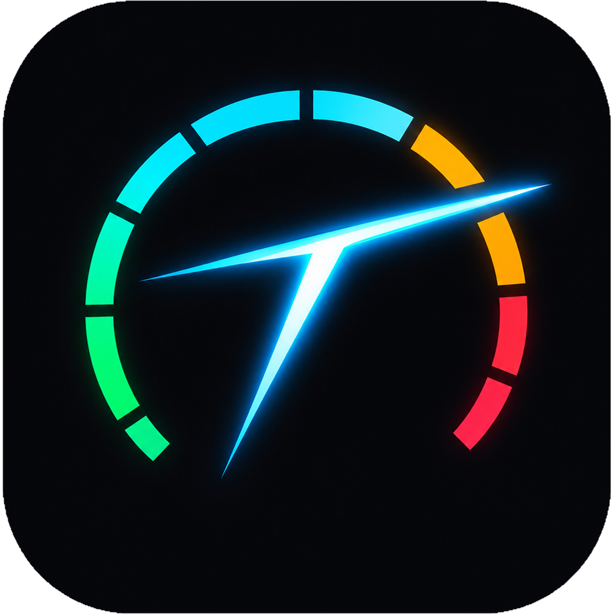
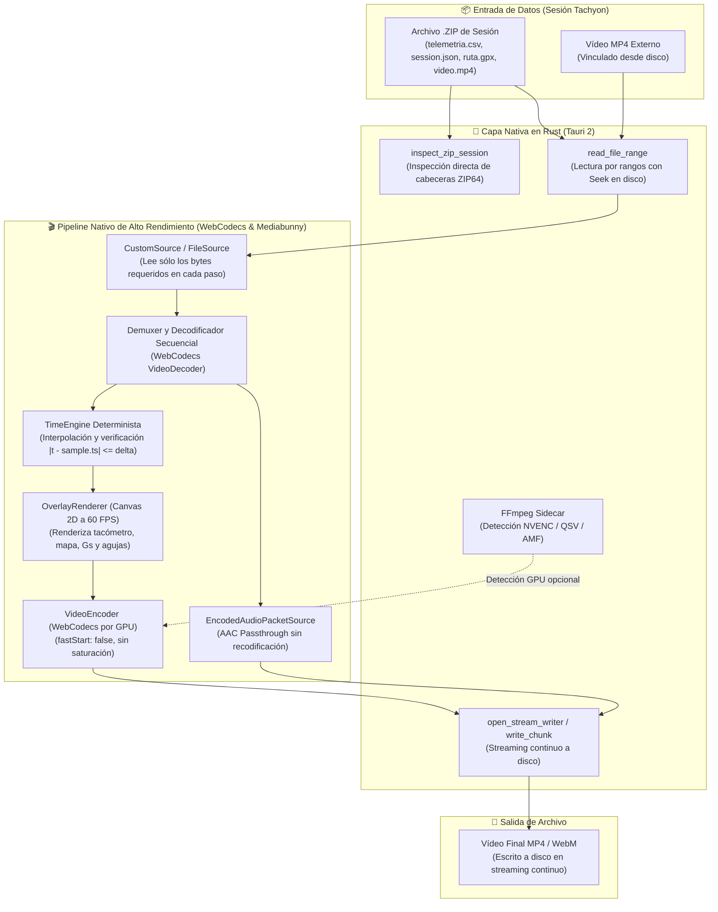

<div align="center">



# Tachyon Studio Desktop 🏁

```
  ████████╗ █████╗  ██████╗██╗  ██╗██╗   ██╗ ██████╗ ███╗   ██╗
  ╚══██╔══╝██╔══██╗██╔════╝██║  ██║╚██╗ ██╔╝██╔═══██╗████╗  ██║
     ██║   ███████║██║     ███████║ ╚████╔╝ ██║   ██║██╔██╗ ██║
     ██║   ██╔══██║██║     ██╔══██║  ╚██╔╝  ██║   ██║██║╚██╗██║
     ██║   ██║  ██║╚██████╗██║  ██║   ██║   ╚██████╔╝██║ ╚████║
     ╚═╝   ╚═╝  ╚═╝ ╚═════╝╚═╝  ╚═╝   ╚═╝    ╚═════╝ ╚═╝  ╚═══╝
                      S T U D I O   D E S K T O P
```

### **Suite Nativa de Escritorio para Telemetría Automovilística, Diseño de Overlays y Exportación de Vídeo a 60 FPS**

[](https://github.com/GuacamoleGH/Tachyon-Studio-Rust)
[](https://tauri.app/)
[](https://www.rust-lang.org/)
[](https://www.typescriptlang.org/)
[](https://react.dev/)
[](https://developer.mozilla.org/en-US/docs/Web/API/WebCodecs_API)
[](https://vitest.dev/)
[](LICENSE)

[**Características**](#-características-principales) •
[**Arquitectura**](#-arquitectura-del-sistema) •
[**Pipeline de Vídeo**](#-pipeline-de-vídeo-con-memoria-acotada) •
[**Catálogo de Widgets**](#-catálogo-de-widgets) •
[**Plantillas Integradas**](#-plantillas-de-instrumentación-integradas) •
[**Inicio Rápido**](#-inicio-rápido) •
[**Guía de Compilación (BUILD.md)**](BUILD.md)

</div>

---

## ⚡ ¿Qué es Tachyon Studio?

**Tachyon Studio** es una aplicación nativa de alto rendimiento para PC diseñada para procesar sesiones de telemetría automovilística procedentes de la app móvil **Tachyon**. 

Permite importar paquetes de sesión (`.zip`) o vincular vídeos MP4 externos junto con datos OBD-II, GPS e IMU para:
- Visualizar y analizar tandas de circuito, rally y carretera abierta con sincronización precisa a 60 FPS.
- Diseñar cuadros de mandos (*overlays*) totalmente personalizados mediante un potente editor visual de arrastrar y soltar.
- Exportar el vídeo final con la instrumentación superpuesta utilizando aceleración gráfica por hardware (**WebCodecs**) y preservando el audio original del motor (**AAC Passthrough**), manteniendo un consumo de memoria RAM ultra bajo (< 500 MB) incluso con archivos de vídeo de 4 a 5 GB.

---

## 🌟 Características Principales

- **Pipeline de Memoria Acotada en Rust:** Lectura eficiente por rangos (*range requests*) directamente desde el archivo `.zip` o disco duro. Nunca carga gigabytes de vídeo en memoria RAM.
- **Renderizado Gráfico a 60 FPS en Canvas 2D:** Instrumentación fluida con interpolación lineal determinista y anti-aliasing de precisión subpíxel.
- **Preservación Íntegra del Audio:** Extracción directa de los paquetes AAC de la cámara del vehículo e incrustación en el MP4 final sin pérdidas de calidad ni recodificación analógica.
- **Sincronización Determinista Fotograma a Fotograma:** Comprobación estricta de marcas de tiempo entre la pista de vídeo y las muestras de telemetría.
- **Editor Visual Interactivo de Plantillas:** Mueve, escala y personaliza cada widget en tiempo real con 8 manejadores de ajuste, cuadrícula y previsualización interactiva.
- **Minimapa GPS de Alta Definición con Zoom Dinámico:** Vista centrada y fluida con zoom ajustable desde curvas cerradas / karting (40 m) hasta tramos de montaña completos (1.200 m).
- **17 Widgets de Competición:** Tacómetros circulares, de barra GT, estilo Forza Motorsport y display horizontal F1 con indicador de marcha, shift lights, círculos G-Meter, altímetro, récords de sesión y coordenadas WGS84.
- **8 Plantillas Profesionales Listas para Usar:** Diseños inspirados en Forza Motorsport, monoplazas de F1, WRC Rally, tandas de Track Day, karting MyChron 5 y cabinas despejadas.
- **100% Local y Privado:** Todo el procesamiento se realiza en tu ordenador sin enviar ningún dato o vídeo a servidores externos.

---

## 🏗️ Arquitectura del Sistema



---

## 🎬 Pipeline de Vídeo con Memoria Acotada

Tachyon Studio está diseñado específicamente para tratar grabaciones onboard extensas (vídeos 1080p y 4K de 30 a 60 minutos):

| Escenario | Consumo de RAM | Rendimiento |
| :--- | :---: | :--- |
| **Sesión Base (Telemetría y Métricas)** | **~110 MB** | Carga instantánea de telemetría y gráficas |
| **Reproducción con Vídeo 1080p (1,5 GB)** | **~180 MB** | Streaming de fotogramas sin precargar el archivo |
| **Vídeo Grande (4,2 GB, 1080p @ 30 FPS, 30 min)** | **~340 MB (Pico)** | Memoria acotada (< 500 MB constantes) |
| **Exportación a MP4 con Telemetría (Tramo 60 s)** | **19 s** | Codificación por GPU secuencial a máxima velocidad |
| **Pista de Audio Original** | **100% Calidad** | Audio estéreo original preservado vía AAC Passthrough |

---

## 📊 Catálogo de Widgets

Tachyon Studio cuenta con una colección de **17 widgets** configurables de diseño automovilístico:

| Widget | Identificador | Descripción | Datos de Entrada |
| :--- | :--- | :--- | :--- |
| **Tacómetro Circular** | `tachometer_circular` | Reloj analógico con aguja fluida, arco de redline, marcha integrada y display digital. | OBD (`engine_rpm`) |
| **Tacómetro Forza Motorsport** | `tachometer_forza` | Cuadro de instrumentos curvo moderno con buje central brillante para marcha y velocímetro. | OBD + GPS |
| **Tacómetro Horizontal F1/GT3** | `tachometer_horizontal` | Display superior de competición con marcha a la izquierda, barra LED de 26 segmentos y velocímetro. | OBD + GPS |
| **Tacómetro de Barra GT** | `tachometer_bar` | Barra horizontal de competición con gradiente dinámico y marcas numéricas. | OBD (`engine_rpm`) |
| **Shift Lights** | `shift_lights` | Tira de LEDs progresivos con parpadeo estroboscópico al régimen de cambio (*shift point*). | OBD + Perfil |
| **Indicador de Marcha (Gear)** | `gear_indicator` | Marcha engranada de gran tamaño (`1` a `6`, `N`, `R`) calculada por relación de transmisión o leída por OBD. | RPM / Velocidad |
| **Velocímetro Digital** | `speedometer` | Velocímetro de alto contraste con selector de fuente (GPS u OBD) y unidades ($\text{km/h}$ o $\text{mph}$). | `gps_speed_kmh` / `obd_speed_kmh` |
| **Pedales Freno y Gas** | `brake_throttle` | Doble barra vertical estilo telemetría F1 (acelerador en verde neón, frenada estimada en rojo). | `throttle_pct` + $\text{G}_{\text{long}}$ |
| **Barra de Acelerador** | `throttle` | Barra vertical compacta de apertura de mariposa ($0 \dots 100\%$). | `throttle_pct` (OBD) |
| **Temperatura de Motor** | `coolant_temp` | Termómetro digital de refrigerante con alerta de color ante sobrecalentamiento. | `coolant_temp_c` (OBD) |
| **G-Meter (Círculo de Kamm)** | `g_meter` | Visualizador biaxial de aceleración lateral y longitudinal con círculos de adherencia ($1.0\text{G}$, $1.5\text{G}$, $2.0\text{G}$). | $\text{IMU}_{\text{lat}}$ + $\text{IMU}_{\text{long}}$ |
| **Barras de Fuerzas G** | `g_force_bars` | Barras lineales independientes para fuerzas G de curva y aceleración/frenada. | $\text{IMU}_{\text{lat}}$ + $\text{IMU}_{\text{long}}$ |
| **Trazada GPS / Minimapa** | `map` | Minimapa fluido centrado en el coche con zoom configurable (40 m a 1.200 m) o circuito estático. | GPS (`lat`, `lon`, `bearing`) |
| **Gráfica de Velocidad** | `speed_graph` | Gráfica continua de perfil de velocidad con aguja sincronizada en el instante actual. | Velocidad vs. Tiempo |
| **Cronómetro de Sesión** | `session_timer` | Contador digital de tiempo transcurrido (soporta tiempos negativos $t < 0$). | Reloj de sincronización |
| **Altitud GPS** | `altitude` | Altitud barométrica/satelital en metros o pies. | GPS (`altitude_m`) |
| **Brújula / Rumbo GPS** | `compass` | Rosa de los vientos digital con rumbo cardinal y grados ($0^\circ \dots 359^\circ$). | GPS (`bearing_deg`) |
| **Récords de Sesión (Max Stats)** | `max_stats` | Panel de hitos máximos: Velocidad punta ($\text{V}_{\text{MAX}}$), Fuerza lateral punta ($\text{G}_{\text{MAX}}$) y RPM máxima. | Récords acumulados |
| **Coordenadas GPS (WGS84)** | `gps_coords` | Coordenadas exactas en grados decimales con estado del enlace satelital (**FIX 3D**). | GPS (`lat`, `lon`) |

---

## 🎨 Plantillas de Instrumentación Integradas

Tachyon Studio incluye **8 plantillas preconfiguradas** listas para usar y exportar con un solo clic:

1. **Forza Motorsport HUD:** Tacómetro curvo estilo Forza con marcha en buje central, velocímetro integrado, pedales, G-Meter, minimapa a 120 m y gráfica de velocidad.
2. **Fórmula 1 & GT Display (Horizontal):** Tacómetro LED superior con marcha integrada, minimapa deportivo a 100 m, récords de sesión (V-MAX) y pedales duales.
3. **WRC Rally & Montaña (Zoom Curvas):** Súper zoom de 80 metros en el minimapa, tacómetro Forza, altímetro, brújula de rumbo y barras de fuerzas G.
4. **Track Day Pro (Telemetría Completa):** Máxima instrumentación para circuito: tacómetro Forza, minimapa de 120 m, temperatura de motor, récords de sesión y barras G.
5. **Clean Cockpit (Ultra Panorámica):** Máxima visibilidad del asfalto: tacómetro en esquina inferior y minimapa deportivo a 100 m en esquina superior.
6. **Cockpit GT3 Pro:** Tacómetro de barra GT, indicador gigante de marcha, pedales duales, temperatura de refrigerante y minimapa.
7. **MyChron 5 (Display Karting):** Disposición clásica de volante de karting con tacómetro circular, shift lights superiores, velocímetro y gráfica.
8. **Barra Inferior Minimalista:** Instrumentación compacta concentrada en el borde inferior para no tapar la vista del trazado.

> [!TIP]
> Puedes modificar cualquier plantilla en el **Editor de Plantillas**, añadir o eliminar widgets, cambiar su posición y tamaño, y tus cambios quedarán guardados de forma automática y persistente en la aplicación.

---

## 🚀 Inicio Rápido

### Ejecución Directa (Sin Necesidad de Instalación)
Si ya tienes la aplicación en tu equipo:
- Haz doble clic en el script **`iniciar_tachyon_directo.bat`**, o
- Ejecuta directamente el binario compilado:  
  `src-tauri/target/release/tachyon-studio.exe`

---

## 🛠️ Compilación y Desarrollo

Las instrucciones detalladas para compilar desde el código fuente, requisitos del sistema, ejecución de los 49 tests con Vitest y generación del instalador para Windows (`.exe` NSIS) se encuentran en la guía dedicada:

👉 **[Consulta la Guía de Compilación en BUILD.md](BUILD.md)**

---

## 🔒 Privacidad y Licencia

- **100% Local:** Ningún fotograma de vídeo ni dato de telemetría se transmite por internet.
- **Licencia:** Distribuido bajo la **Licencia MIT**.
