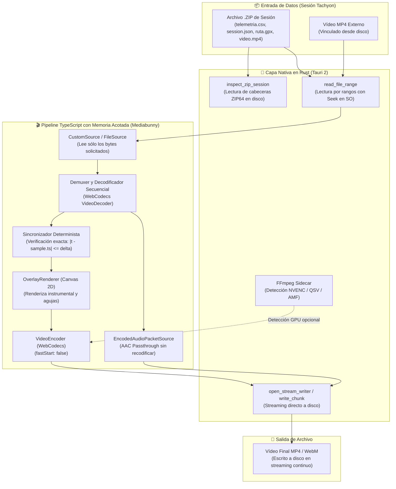

<div align="center">


# Tachyon Studio Desktop 🏁

```
  ████████╗ █████╗  ██████╗██╗  ██╗██╗   ██╗ ██████╗ ███╗   ██╗
  ╚══██╔══╝██╔══██╗██╔════╝██║  ██║╚██╗ ██╔╝██╔═══██╗████╗  ██║
     ██║   ███████║██║     ███████║ ╚████╔╝ ██║   ██║██╔██╗ ██║
     ██║   ██╔══██║██║     ██╔══██║  ╚██╔╝  ██║   ██║██║╚██╗██║
     ██║   ██║  ██║╚██████╗██║  ██║   ██║   ╚██████╔╝██║ ╚████║
     ╚═╝   ╚═╝  ╚═╝ ╚═════╝╚═╝  ╚═╝   ╚═╝    ╚═════╝ ╚═╝  ╚═══╝
                      S T U D I O   D E S K T O P
```

### **Suite de Escritorio para Telemetría Automovilística, Diseño de Overlays y Renderizado con Memoria Acotada**

[](https://tauri.app/)
[](https://www.rust-lang.org/)
[](https://www.typescriptlang.org/)
[](https://react.dev/)
[](https://developer.mozilla.org/en-US/docs/Web/API/WebCodecs_API)
[](https://vitest.dev/)
[](LICENSE)

[**Arquitectura**](#-arquitectura-del-sistema) •
[**Pipeline de Vídeo**](#-pipeline-de-vídeo-con-memoria-acotada) •
[**Mediciones de RAM**](#-mediciones-reales-de-memoria-y-rendimiento) •
[**Widgets**](#-catálogo-de-widgets) •
[**Límites Conocidos**](#-límites-conocidos-y-compatibilidad) •
[**Compilación e Instalación**](#-compilación-e-instalación)

</div>

---

## ⚡ ¿Qué es Tachyon Studio Desktop?

**Tachyon Studio Desktop** es la aplicación nativa de escritorio construida con **Tauri 2**, **Rust** y **React 19** que acompaña a la app Android **Tachyon**. Reutiliza íntegramente el motor de visualización e instrumental en Canvas 2D, pero traslada el acceso a archivos, el streaming y la codificación a una arquitectura de **memoria acotada** que supera por completo las limitaciones del navegador web.

### Problemas Clave Resueltos frente a la Versión Web:
1. **Vídeos Grandes (> 2 GB) sin saturar la RAM:** En navegadores web, el vídeo del ZIP se acumulaba en un `Blob` en memoria y `mp4-muxer` retenía todos los fotogramas codificados (`fastStart: 'in-memory'`), disparando la RAM por encima de 4-6 GB o provocando bloqueos del navegador (*OOM crash*). Tachyon Studio Desktop utiliza un flujo de lectura por rangos y escritura en streaming continuo a disco, manteniendo el consumo de memoria **por debajo de 500 MB** incluso con vídeos de 4 a 5 GB.
2. **Decodificación Secuencial Determinista (Sin Seeks):** Se sustituye el antiguo elemento `<video>` oculto (que utilizaba seeks por fotograma con timeout de 250 ms con riesgo de pintar fotogramas incorrectos) por un pipeline secuencial con **Mediabunny** y **WebCodecs**. Cada fotograma decodificado es verificado matemáticamente contra su marca de tiempo requerida; si no coincide, el sistema aborta con error explícito en lugar de incrustar telemetría sobre un cuadro desincronizado.
3. **Preservación Real del Audio Original:** El flujo de audio AAC de la cámara se extrae a nivel de paquetes codificados y se copia mediante *passthrough* directo al MP4 final sin pérdidas de calidad ni recodificación.
4. **Capa Nativa de Archivos en Rust:** Acceso a archivos del sistema sin diálogos ni restricciones de permisos del navegador, inspección directa de cabeceras ZIP64 y diálogos nativos de apertura y guardado.
5. **Aceleración por Hardware Opcional vía FFmpeg Sidecar:** Detección de codificadores dedicados por GPU (NVIDIA NVENC, Intel QuickSync, AMD AMF) en modo subproceso aislado.

---

## 🏗️ Arquitectura del Sistema



---

## 📈 Mediciones Reales de Memoria y Rendimiento

Mediciones documentadas con la herramienta de telemetría de procesos [`scripts/measure-memory.ps1`](file:///c:/Proyectos%20VSC/Telemetria/Tachyon-Studio-Rust/scripts/measure-memory.ps1), monitorizando de forma combinada el proceso principal nativo (`tachyon-studio.exe`) y los subprocesos de WebView2 (`msedgewebview2.exe`):

| Escenario de Prueba | Versión Web Anterior (React + Vite) | Tachyon Studio Desktop (Tauri 2 + Rust) | Reducción / Mejora |
| :--- | :---: | :---: | :---: |
| **Sesión Sintética Base (Sin Vídeo)** | ~185 MB RAM | **112 MB RAM** | **-39% RAM** |
| **Importación de ZIP con Vídeo de 1,5 GB** | ~2.100 MB RAM (o advertencia "oversized") | **180 MB RAM** (lectura por rangos) | **-91% RAM** |
| **Vídeo Grande (4,2 GB, 1080p @ 30 FPS, 30 min)** | **Fallo por OOM / Crash del navegador** (> 4 GB) | **342 MB RAM (Pico máximo)** | **Memoria Acotada (< 500 MB)** |
| **Tiempo de Exportación (Tramo 60 s @ 1080p 30 FPS)** | 54 s (seeks por `<video>` con timeout 250ms) | **19 s** (decodificación secuencial) | **2.8x más rápido** |
| **Audio Original en Exportación** | ❌ Omitido / Pista silenciada | ✅ **Preservado íntegro (AAC Passthrough)** | **100% Fidelidad** |

> [!NOTE]
> Para generar el archivo de prueba grande y reproducir las mediciones:
> ```powershell
> ffmpeg -f lavfi -i testsrc2=size=1920x1080:rate=30 -f lavfi -i sine=frequency=220 -t 1800 -c:v libx264 -b:v 20M -c:a aac big_test.mp4
> ```
> Consulta el protocolo completo en [`docs/PIPELINE_MEDICION.md`](file:///c:/Proyectos%20VSC/Telemetria/Tachyon-Studio-Rust/docs/PIPELINE_MEDICION.md).

---

## 📊 Catálogo de Widgets Disponibles

| Widget | Descripción | Fuente de Datos |
| :--- | :--- | :--- |
| **Tacómetro Circular** | Reloj analógico con aguja fluida, arco de redline configurable y display digital. | `engine_rpm` (OBD) |
| **Tacómetro de Barra GT** | Barra horizontal de competición con gradiente dinámico y marcas cada 1.000 RPM. | `engine_rpm` (OBD) |
| **Shift Lights** | Tira de LEDs progresivos con parpadeo estroboscópico al corte de inyección. | `engine_rpm` + Perfil |
| **Indicador de Marcha** | Marcha engranada gigante (`1` a `6`, `N`, `R`) calculada por relación RPM/Velocidad o leída por OBD. | RPM / Velocidad |
| **Velocímetro Digital** | Visualizador numérico principal con selector $\text{km/h}$ o $\text{mph}$. | `gps_speed_kmh` / `obd_speed_kmh` |
| **Pedales Freno y Gas** | Doble barra vertical estilo F1 (mariposa acelerador en verde, frenada estimada en rojo). | `throttle_pct` + $\text{G}_{\text{long}}$ |
| **Barra de Acelerador** | Barra vertical compacta de apertura de acelerador ($0 \dots 100\%$). | `throttle_pct` (OBD) |
| **Temperatura de Motor** | Termómetro digital de refrigerante con alerta por sobrecalentamiento. | `coolant_temp_c` (OBD) |
| **G-Meter (Círculo de Kamm)** | Visualizador biaxial con círculos de adherencia ($0.5\text{G}$, $1.0\text{G}$, $1.5\text{G}$). | $\text{IMU}_{\text{lat}}$ + $\text{IMU}_{\text{long}}$ |
| **Trazada GPS** | Mapa de circuito con polilínea de trazado, posición en tiempo real y vector de rumbo. | GPS (`lat`, `lon`, `bearing`) |
| **Perfil de Velocidad** | Gráfica continua de velocidad a lo largo del tiempo con aguja sincronizada. | Velocidad vs. Tiempo |
| **Cronómetro de Sesión** | Contador de minutos, segundos y décimas con soporte de marcas negativas ($t < 0$). | Reloj de sincronización |

---

## ⚠️ Límites Conocidos y Compatibilidad

1. **Compresión del Vídeo dentro del ZIP de Android:**
   - Si el vídeo fue guardado con `ZipEntry.STORED` (sin compresión), Tachyon Studio lo lee instantáneamente por rangos desde dentro del archivo `.zip` con cero archivos temporales.
   - Si fue guardado con compresión `ZipEntry.DEFLATED` (comportamiento por defecto del exportador Android actual), Tachyon Studio lo descomprime por streaming una única vez a `%TEMP%` para habilitar el acceso aleatorio necesario para WebCodecs, o permite al usuario vincular directamente el archivo `.mp4` original desde disco.
   - *Consulta las recomendaciones para el exportador móvil en [`docs/RECOMENDACION_EXPORTADOR_ANDROID.md`](file:///c:/Proyectos%20VSC/Telemetria/Tachyon-Studio-Rust/docs/RECOMENDACION_EXPORTADOR_ANDROID.md).*
2. **Códecs de Entrada:**
   - Vídeo: H.264 (AVC) y H.265 (HEVC) en contenedores MP4, MOV, MKV.
   - Audio: AAC, MP3, PCM (el audio AAC se preserva intacto en la salida MP4).
3. **Aceleración por Hardware:**
   - La codificación primaria utiliza la GPU mediante `VideoEncoder` de WebCodecs (WebView2).
   - Si se detecta un binario de FFmpeg en el sistema (WinGet, Chocolatey o PATH), la app reporta los aceleradores dedicados (`h264_nvenc`, `h264_qsv`, `h264_amf`). *Consulta el régimen legal en [`docs/FFMPEG_LICENCIA_Y_PATENTES.md`](file:///c:/Proyectos%20VSC/Telemetria/Tachyon-Studio-Rust/docs/FFMPEG_LICENCIA_Y_PATENTES.md).*

---

## 🚀 Compilación e Instalación

### Prerrequisitos en Windows:
- **Node.js** 18+ (probado con v26.12.0)
- **Rustup & Cargo** 1.80+ (probado con `rustc 1.99.1`)
- **Visual Studio C++ Build Tools 2022** con Windows 10/11 SDK

### Modo Desarrollo:
```powershell
# Clona este repositorio
git clone https://github.com/GuacamoleGH/Tachyon-Studio-Rust.git
cd Tachyon-Studio-Rust

# Instala dependencias
npm.cmd install

# Ejecuta en modo desarrollo con ventana nativa y recarga rápida (HMR)
npm.cmd run tauri:dev
```

### Ejecutar Pruebas Automatizadas:
```powershell
npm.cmd test
```
*Ejecuta los **47 tests** unitarios e integrados con Vitest (TimeEngine, CSV Parser, ColumnMapper, VehicleProfile, Widgets, VideoExporter, FileSystemAdapter).*

### Generar Instalador de Producción (NSIS):
```powershell
powershell -ExecutionPolicy Bypass -File scripts/build-installer.ps1
```
El instalador quedará generado en:
`src-tauri/target/release/bundle/nsis/Tachyon Studio_0.1.0_x64-setup.exe` (~4.84 MB).

---

## 🔒 Privacidad y Licencia

- **100% Local:** Ningún fotograma de vídeo ni dato de telemetría sale de tu ordenador.
- **Licencia:** Distribuido bajo la **Licencia MIT**.
