# 📊 Catálogo Oficial de Widgets de Telemetría — Tachyon Studio

Tachyon Studio Desktop cuenta con **24 widgets de instrumentación y telemetría** totalmente interactivos, redimensionables y configurables para componer el panel de instrumentos de competición en tus vídeos de carreras, trackdays, karting o tramos.

---

## 🏎️ 1. Tacómetros y Gestión de Régimen (RPM)

| Vista Previa | Widget | Tipo | Descripción |
| :---: | :--- | :---: | :--- |
| 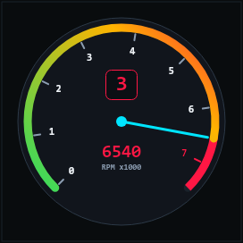 | **Tacómetro Circular Deportivo** | `tachometer_circular` | Dial circular con aguja balística fluida, estela de inercia deportiva, marcadores graduados, zona de línea roja (*redline*) configurable y valor digital en el centro. |
| 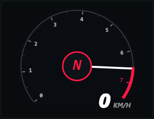 | **Tacómetro Racing Estilo Forza** | `tachometer_forza` | Inspirado en la interfaz de Forza Motorsport. Arco curvado con gradiente progresivo de color (verde, amarillo y rojo), aguja iluminada y marcha engranada integrada. |
| 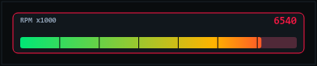 | **Tacómetro de Barra GT** | `tachometer_bar` | Barra horizontal de competición estilo GT3 / DTM con segmentos dinámicos que se iluminan progresivamente al aproximarse al corte de inyección. |
| 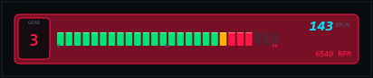 | **Tacómetro Horizontal F1 / Pro** | `tachometer_horizontal` | Diseño ultra-panorámico de monoplaza moderno con display numérico y parpadeo de aviso de cambio de marcha (*shift alert*). |
| 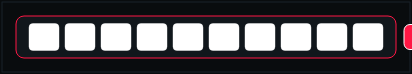 | **Luces de Cambio Pro (Shift Lights)** | `shift_lights` | Tira de LEDs secuenciales multietapa de alta visibilidad (verdes, amarillos y rojos/azules) con destello estroboscópico sincronizado al régimen óptimo. Patrones configurables (*center-out*, *left-to-right*). |

---

## ⚡ 2. Velocidad, Marchas y Pedales

| Vista Previa | Widget | Tipo | Descripción |
| :---: | :--- | :---: | :--- |
| 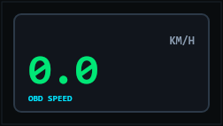 | **Velocímetro Digital** | `speedometer` | Velocímetro numérico de gran tamaño con tipografía deportiva, unidades configurables (km/h o mph) y selección de fuente preferida (GPS o sensor de rueda OBD-II). |
|  | **Indicador de Marcha (Gear)** | `gear_indicator` | Dígito gigante de cambio rápido con soporte completo para marchas directas (`1` a `8`), punto muerto (`N`) y marcha atrás (`R`). |
| 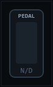 | **Pedal de Acelerador** | `throttle` | Barra vertical con respuesta instantánea de 0 a 100% que muestra el recorrido y porcentaje de apertura del acelerador en tiempo real. |
| 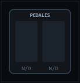 | **Pedales Duales Competición** | `brake_throttle` | Doble barra vertical para análisis de técnica de conducción, frenada con pie izquierdo y punta-tacón (Freno en rojo y Acelerador en verde). |

---

## 🔧 3. Diagnosis Motor y Eficiencia OBD-II

| Vista Previa | Widget | Tipo | Descripción |
| :---: | :--- | :---: | :--- |
| 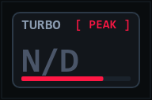 | **Presión de Turbo (Boost)** | `boost` | Manómetro digital con lectura de presión en bares o PSI, barra de progresión semicircular y lectura precisa tanto de vacío motor como de sobrealimentación. |
|  | **Consumo de Combustible** | `fuel_consumption` | Medidor de consumo instantáneo en L/100km (o MPG) con visualizador de barras dinámicas y color adaptativo según eficiencia. |
| 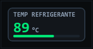 | **Temp. Refrigerante Motor** | `coolant_temp` | Monitor térmico de la temperatura del líquido refrigerante con avisos cromáticos automáticos (azul en frío, verde en óptimo y rojo en sobrecalentamiento). |
| 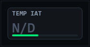 | **Temp. Aire Admisión (IAT)** | `intake_temp` | Lectura de la temperatura del aire en el colector de admisión tras el intercooler (°C o °F), vital para evaluar el rendimiento térmico y prevenir pérdidas de potencia (*heat soak*). |

---

## 🎯 4. Dinámica del Chasis y Fuerzas G

| Vista Previa | Widget | Tipo | Descripción |
| :---: | :--- | :---: | :--- |
| 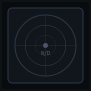 | **G-Meter (Acelerómetro Circular)** | `g_meter` | Diana balística G-G que muestra vectorialmente las fuerzas de aceleración lateral y longitudinal combinadas. Escala ajustable (1.0G, 1.5G, 2.0G). |
| 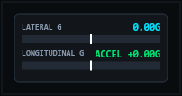 | **Barras de Fuerzas G Duales** | `g_force_bars` | Barras horizontales independientes que separan con precisión el apoyo lateral en curva (izq/der) y la inercia longitudinal (aceleración/frenada). |
| 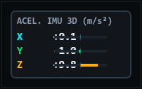 | **Aceleración Bruta IMU 3D** | `imu_raw` | Lectura directa triaxial en metros por segundo al cuadrado (m/s²) de los ejes X, Y y Z del sensor inercial físico. |

---

## 🗺️ 5. Navegación Satelital y Tiempo

| Vista Previa | Widget | Tipo | Descripción |
| :---: | :--- | :---: | :--- |
|  | **Trazada GPS / Minimapa** | `map` | Minimapa del circuito o tramo con trazada en vivo, posición actual, modo norte arriba o seguimiento con rotación de rumbo (*chase heading*), zoom ajustable y fondos cartográficos (OpenStreetMap, CartoDB Dark/Voyager). |
| 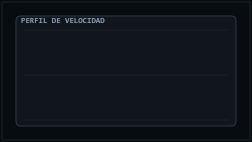 | **Gráfica de Velocidad Continua** | `speed_graph` | Oscilograma dinámico que muestra el perfil de velocidad de los últimos segundos para visualizar puntos de frenada y aceleración. |
| 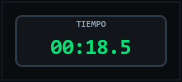 | **Cronómetro de Sesión** | `session_timer` | Contador de tiempo transcurrido de alta precisión con formato de minutos, segundos y milisegundos (`mm:ss.ms`). |
| 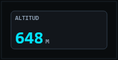 | **Altitud GPS** | `altitude` | Medidor de elevación satelital sobre el nivel del mar en metros o pies. |
| 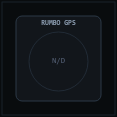 | **Brújula y Rumbo GPS** | `compass` | Rosa de los vientos circular con aguja de orientación hacia el norte y rumbo numérico en grados (0° a 360°). |
| 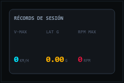 | **Récords de Sesión (Max Stats)** | `max_stats` | Cuadro de honor con los valores máximos alcanzados en la sesión: Velocidad punta, Régimen máximo de RPM y Pico de Fuerza G lateral. |
| 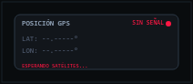 | **Coordenadas Satelitales (WGS84)** | `gps_coords` | Display de latitud y longitud con 6 cifras decimales de precisión satelital. |
| 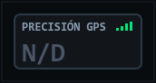 | **Precisión Satelital (GNSS)** | `gps_accuracy` | Gráfico de 4 barras de cobertura satelital e incertidumbre estimada en metros para verificar la calidad de la señal satelital en circuito. |
